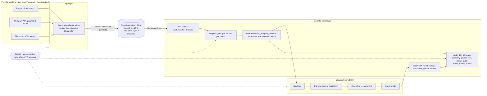

# company-data-platform

Takes company records from three providers that disagree with each other (a business
registry, a company API and a scraped business directory) and turns them into **one trusted,
deduplicated record per company**. Each record keeps field-level provenance and an audit trail
for every merge decision.

It covers the whole path: resilient async ingestion into an immutable raw layer, a dbt +
DuckDB medallion warehouse with enforced contracts, a Python entity-resolution engine that
reports its own precision and recall against labelled data, and Dagster assets that tie it
together on a daily schedule. Everything runs offline on synthetic fixtures.

```text
$ cdp run && cdp eval
records                      515
true_entities                218
predicted_entities           221
precision                    1.0
recall                       0.9879
f1                           0.9939
blocking_recall              0.9952
uncertain_pairs              22
baseline_exact_name_country  {'precision': 1.0, 'recall': 0.6981, 'f1': 0.8222}
```

## Architecture



## Quickstart

Requires Python 3.12 and [uv](https://docs.astral.sh/uv/) (plain `pip` works too).

```bash
uv sync --all-extras                 # or: python3.12 -m venv .venv && pip install -e ".[dev,orchestration]"
source .venv/bin/activate

cdp run                              # ingest -> dbt upstream -> resolve -> dbt marts
cdp eval                             # precision / recall / F1 against ground truth
pytest                               # 79 tests: unit + end-to-end (pipeline and Dagster job)
(cd dbt && dbt build)                # all models, contracts and 63 data tests
dagster dev                          # UI at http://localhost:3000, module from pyproject
```

Step by step:

| Command | What it does |
| --- | --- |
| `cdp ingest` | Fetches all three providers concurrently, lands raw payloads, loads `raw.*`. Rerunning loads nothing new. |
| `cdp transform` | `dbt build` for seeds, staging and intermediate: the inputs to resolution. `--stage all` builds everything. |
| `cdp resolve` | Blocks, scores, clusters and survives records, writes `resolved.*`, then builds the marts. |
| `cdp eval` | Re-runs resolution in memory (writes nothing) and scores it against `fixtures/ground_truth.csv`. `--json out.json` writes the metrics. |
| `cdp run` | All of the above in order. |

Data goes to `./data` (warehouse `data/warehouse.duckdb`, raw lake `data/lake/`). Override
with `CDP_DATA_DIR`, `CDP_WAREHOUSE` and `CDP_FIXTURES_DIR`.

Explore the result with the DuckDB CLI:

```bash
duckdb data/warehouse.duckdb -c "select entity_id, company_name, domain, country_code, sources from marts.dim_company where source_count = 3 limit 5"
duckdb data/warehouse.duckdb -c "select left_company_name, right_company_name, score, reason from marts.match_review_queue order by score desc limit 10"
```

## The data

`scripts/generate_fixtures.py` generates the fixtures from a fixed seed. All company names
are made up. There are **220 entities and 515 records**:

| Provider | Format | Records | Typical problems |
| --- | --- | --- | --- |
| registry | CSV bulk export | 176 | legal-form variants (`G.m.b.H.`, `Aktiengesellschaft`), uppercase names, two date formats, country spelled out (`Deutschland`, `République française`) |
| api | paginated JSON (4 pages) | 175 | messy websites (`HTTPS://WWW.X.DE`, `/about-us`), regional vs global domains, conflicting headcount, newer addresses after moves |
| directory | JSONL | 164 | typos, collapsed spacing (`CobaltRidge`), free-mail contacts (`gmail.com`), phone formats (`+49…`, `0049…`), duplicate listings of the same business |

The fixtures also contain **24 hard negatives**. Twelve are a company with the same trading
name as another but in a different country. The other twelve are near-twins in the same
country (`Kestrel Data` vs `Kestrel Data Labs`), each with its own domain and address. Every
record has a labelled `entity_id` in `ground_truth.csv`.

A second set, `fixtures/holdout/` (seed 7, 507 records), is used only for evaluation. It was
generated before the one scoring fix described below, and I only ever looked at its aggregate
metrics, never at individual errors.

## Medallion layers

| Layer | Where | Materialisation | Contents |
| --- | --- | --- | --- |
| Raw (landing) | `data/lake/cdp-raw/source=<src>/sha256=<checksum>.<ext>` | immutable objects | The exact bytes each provider returned. Metadata sidecar holds `source`, `fetched_at`, `checksum`, `request_url`, `content_type`. |
| Bronze | `raw.registry_companies`, `raw.api_companies`, `raw.directory_listings`, `raw.load_manifest` | tables (Python loader) | One JSON `payload` per record with `_checksum`, `_fetched_at`, `_object_uri`. The manifest is the idempotency ledger. |
| Silver: staging | `staging.stg_*` | dbt views | Per-source typing, trimming and blank-to-null. Nested JSON flattened, free-text address split. Latest version per source key. |
| Silver: intermediate | `intermediate.int_company_records` | dbt table | All sources in one shape: `name_norm` (legal suffix stripped, unicode folded), `name_key`, `legal_form`, `domain` (from URL or e-mail, free-mail dropped), `phone_norm`, ISO `country_code` via an alias seed. |
| Resolved | `resolved.entity_membership`, `resolved.pair_scores`, `resolved.golden_records` | tables (Python) | Output of `cdp.resolve`, replaced in a single transaction. |
| Gold: marts | `marts.dim_company`, `marts.company_source_xref`, `marts.match_audit`, `marts.match_review_queue` | dbt tables, **`contract: enforced`** | Golden records with `field_provenance` JSON, the crosswalk from source records to entities, every scored pair with its features, and the steward review queue. |

Quality gates in dbt (63 data tests): `unique`, `not_null`, `relationships` (each country
code exists in the reference seed, each crosswalk row points at a `dim_company` row),
`accepted_values` (status, source, decision, link type), a custom `positive_value` generic
test, primary-key and not-null constraints on the marts, and singular tests:

- no normalised name still ends in a legal form,
- every source record shows up in the crosswalk (nothing dropped silently),
- every accepted match pair ends up in the same entity,
- no entity contains two different registry registrations.

Raw sources have **freshness** settings (`warn_after: 26h`, `error_after: 72h`, on
`_fetched_at`), which fits the daily schedule. Check them with `dbt source freshness`.

## Entity resolution

1. **Blocking.** Each record emits several keys: `domain`, `first 4 chars of name_key +
   country`, `last-token/first-token signature + country`, and `phone`. Two records become a
   candidate pair if they share any key. Blocks with more than 40 members are skipped and
   logged, so a shared hosting domain can't blow up to O(n²). Result: 676 candidate pairs
   instead of about 132k, while keeping 99.5% of true pairs.
2. **Scoring.** Interpretable features computed with `rapidfuzz`: name similarity (Indel
   ratio on the normalised name and on the space-free key), Jaro-Winkler, *unexplained extra
   words* (`Kestrel Data` vs `Kestrel Data Labs`; typos and collapsed spacing don't count),
   and domain, phone, country, city and street agreement. These are combined in log-odds
   space with hand-set, documented weights (`scoring.WEIGHTS`), Fellegi-Sunter style. A
   missing value is neutral evidence, not a mismatch.
3. **Decision.** If score ≥ 0.90 the pair is merged. If it is between 0.50 and 0.90 it goes to
   the **review queue** and is never merged automatically. Below 0.50 it is a non-match.
4. **Clustering.** Union-find (path halving, union by size) is applied to match edges in
   descending score order with a **cannot-link** constraint: two different registry
   registrations are by definition different legal entities. An edge that would join them is
   vetoed and sent to review with reason `cannot_link:registry`.
5. **Survivorship.** For each field, the value comes from the most trusted source that has
   one (`registry` for legal name, registration, status and address; `api` for website,
   headcount and industry; `directory` for phone). Ties go to the most recently updated
   record, then to the smallest `record_id` so the result is deterministic. Related fields
   survive together (street and city come from the same record), and every value records
   which record it came from.

### Measured metrics

Pairwise metrics (over all record pairs that share a cluster) come from `cdp eval`. These are
the actual numbers from this repository:

| Dataset | Records | True entities | Predicted entities | Precision | Recall | F1 | Blocking recall | Candidate pairs | Review queue (true matches in it) |
| --- | ---: | ---: | ---: | ---: | ---: | ---: | ---: | ---: | ---: |
| dev fixtures (seed 20261026) | 515 | 218 | 221 | **1.000** | **0.988** | **0.994** | 0.995 | 676 | 22 (7) |
| holdout fixtures (seed 7) | 507 | 217 | 218 | **1.000** | **0.995** | **0.998** | 0.995 | 641 | 23 (0) |
| baseline: exact `name_norm` + country (dev) | 515 | 218 | n/a | 1.000 | 0.698 | 0.822 | n/a | n/a | n/a |
| baseline: exact `name_norm` + country (holdout) | 507 | 217 | n/a | 1.000 | 0.704 | 0.826 | n/a | n/a | n/a |

How to read these numbers:

- The baseline already has perfect precision, so the resolver's value is **recall**: it goes
  from 0.70 to 0.99 without losing any precision.
- Most of the review queue is hard negatives. On dev, 15 of the 22 queued pairs really are
  different companies, and on holdout all 23 are. These are the pairs a careless threshold
  would have merged.
- After looking at dev errors I fixed one real defect: the "extra words" feature was counting
  typos and collapsed spacing as new words. That moved dev recall from 0.925 to 0.988. I made
  no weight or threshold changes after that.
- **Caveat:** this is synthetic data whose noise model I wrote. Real registry and directory
  data has failure modes that aren't modelled here: rebrands, holding/subsidiary structures,
  shared addresses in business parks, and transliteration from non-Latin scripts. Expect
  noticeably lower numbers on real data. The value of the setup is that the harness
  (labels, `cdp eval`, the review queue, `match_audit`) makes those numbers measurable.

To reproduce the holdout row:

```bash
export CDP_FIXTURES_DIR=$PWD/fixtures/holdout CDP_DATA_DIR=/tmp/cdp-holdout
cdp run && cdp eval
```

## Ingestion details

- **Clients** (`ingest/clients.py`): `httpx.AsyncClient`. The three sources are fetched
  concurrently and API pages are followed through `next_page`.
- **Rate limiting**: an async token bucket per client with an injectable clock.
- **Retries** (`ingest/resilience.py`): full-jitter exponential backoff,
  `uniform(0, min(cap, base·2^n))`. Retries cover transport errors and 408/425/429/5xx, honour
  `Retry-After`, and fail fast on other 4xx. Unit tests use a fake clock, so nothing sleeps.
- **Offline mode**: `FixtureProvider` serves the fixtures through `httpx.MockTransport` with
  the same URLs, pagination and content types as the real providers. It **injects a 429 or
  503 every 4th request**, so the retry path runs on every `cdp run`, not only in unit tests.
- **Raw storage** (`ingest/storage.py`): mirrors the `google.cloud.storage` subset in use
  (`client.bucket().blob()`, `upload_from_string(if_generation_match=0)`,
  `download_as_bytes`, `list_blobs(prefix=)`, `metadata`). Moving to GCS means changing the
  constructor. Writes are atomic (temp file + rename), and names are checked against path
  traversal.
- **Idempotency**: objects are content-addressed by SHA-256. A re-fetch with identical bytes
  writes nothing (create-only precondition) and loads nothing (the checksum is already in
  `raw.load_manifest`). Each object loads in a single transaction. Staging deduplicates on
  source keys, so a changed page only produces new versions of the records that changed.

## Orchestration

`src/cdp/orchestration/definitions.py` defines Dagster software-defined assets:

- `ingest_providers`: a multi-asset producing `raw/*`, retry policy 3× exponential with full
  jitter.
- `dbt_upstream`: seeds, staging and intermediate as dbt assets via `dagster-dbt`. dbt tests
  become **asset checks**.
- `resolve_entities`: a multi-asset producing `resolved/*`. It depends on
  `intermediate/int_company_records` and the dbt sources map onto it, so it sits *between*
  the two dbt groups in one lineage graph.
- `dbt_marts`: the gold models plus their tests.
- The `daily_refresh` job runs every asset on a **daily 05:00 UTC schedule**.

`tests/e2e/test_dagster.py` runs the whole job in-process and asserts that every asset
materialises and every asset check passes.

## Design decisions and trade-offs

- **One normalisation implementation.** `cdp.normalize` is plain Python. A small dbt-duckdb
  plugin registers it as DuckDB UDFs (`cdp_normalize_name`, …), so the SQL layer and the
  resolver can't drift apart, and the Python unit tests also cover the SQL. The cost is that
  models calling UDFs must be tables (a view would fail outside a dbt session) and
  normalisation runs row by row in Python, which is fine at this scale but would be the first
  thing to vectorise.
- **Entity resolution in Python, not SQL.** Blocking and scoring could be written in SQL, but
  union-find with constraints and per-field survivorship are clearer and much easier to test
  in Python. dbt stays in charge of shape and quality, and the resolver's outputs come back
  in as dbt sources, so lineage and tests cover them.
- **Two dbt passes around the resolver**, with `--indirect-selection buildable`. Mart tests
  that also reference intermediate models (relationships, the "nothing dropped" check) then
  run in the marts pass. They don't fire too early as with dbt's default `eager`, and they
  aren't skipped as with `cautious`.
- **Hand-set weights instead of a learned model.** With a few hundred labelled records a
  classifier would overfit and be harder to explain. Log-odds weights are readable ("a shared
  phone number is worth +3.0"), and `match_audit` stores every feature so a model can be
  trained later from steward decisions.
- **Review queue over forced decisions.** Uncertain pairs are kept apart. That costs a little
  recall (7 true dev pairs wait in the queue) but avoids silent over-merges, which are far
  more expensive to undo downstream.
- **Strongest edges first plus cannot-link** limits union-find's well-known chaining problem
  without the cost of full correlation clustering.
- **Content-addressed raw layer.** Replays, backfills and audits are trivial, and duplicate
  fetches cost nothing.

## Limitations

- **Entity ids** are derived from the smallest member `record_id`. They are stable across
  reruns (this is tested), but a merge or split that changes a cluster's smallest member
  changes its id. Production would keep an id-assignment table that carries ids forward by
  maximum overlap.
- The resolver recomputes everything on each run, which is O(candidate pairs) and fine for
  thousands of records. Incremental resolution (score only new or changed records against
  their blocks) is not implemented.
- No steward feedback loop yet: decisions in the review queue aren't read back as
  must-link/cannot-link constraints.
- Countries outside the 10 in the seed fail the `country_code` tests by design. Adding a
  country means adding seed rows.
- Clients only run against the fixture transport. Pointing them at real endpoints would also
  need auth and per-provider schemas.
- Union-find can still chain through a run of individually strong edges. Cannot-link only
  guards the registry case.
- The GitHub Actions workflow is written and its steps were run locally, but it has not run
  on GitHub yet.

## Roadmap

- Persistent entity-id registry with overlap-based carry-forward and merge/split events.
- Incremental resolution driven by the `load_manifest` delta.
- Steward decisions from `match_review_queue` fed back as constraints and training labels;
  calibrate thresholds with a small logistic model once there are enough labels.
- Swap `LocalFilesystemClient` for `google.cloud.storage` and DuckDB for BigQuery or
  MotherDuck through dbt targets.
- Dagster partitions per provider and fetch date; freshness policies on the raw assets.
- Vectorise normalisation (DuckDB native functions or Arrow UDFs).

## Project layout

```text
src/cdp/
  ingest/          clients, rate limiting + retries, fixture transport, raw storage, loader
  resolve/         records, blocking, scoring, clustering, survivorship, engine, evaluate
  orchestration/   Dagster definitions
  normalize.py     shared normalisation (also registered as DuckDB UDFs)
  dbt_plugin.py    dbt-duckdb plugin that registers the UDFs
  transform.py     dbt programmatic runner
  cli.py           cdp ingest | transform | resolve | eval | run
dbt/               dbt project (seeds, staging, intermediate, marts, tests, macros)
fixtures/          synthetic provider data + ground truth (dev) and fixtures/holdout/
scripts/           fixture generator
tests/unit/        normalisation, blocking, scoring, union-find, survivorship, backoff, idempotency
tests/e2e/         full pipeline on fixtures; Dagster job execution
.github/workflows/ci.yml   ruff, pytest, cdp run, dbt build, freshness, eval, Dagster validate
```

## License

MIT, see [LICENSE](LICENSE).
